# HIG package migration evidence · 2026-10-14

Part of [bloxwap/hig#34](https://github.com/bloxwap/hig/issues/34), following the
[SDK docs migration guide](https://github.com/bloxwap/hig/blob/7c67a07/docs/migration/sdk-docs.md).

- Baseline: Hyperliquid `33e42d7` (after [PR #179](https://github.com/bloxwap/hyperliquid/pull/179), which used a
  hand-copied plain-CSS snapshot of HIG `1a776b9`).
- HIG: `0.1.0-candidate.sha7c67a07c`, packed tarballs in [`vendor/bloxwap-hig`](../../../../vendor/bloxwap-hig/README.md)
  (provenance, hashes, update and rollback). Nothing is published, tagged or released.

## What changed

| Area | Before | After |
| --- | --- | --- |
| Tokens and palette | Copied `tokens.css`/`styles.css` (private `@bloxwap/hig-docs-css`) plus a 15-variable `--color-*` alias layer | `@bloxwap/hig-tokens/css` and `@bloxwap/hig-react/css`; the CSS reads `--hig-*` directly; no alias layer |
| Shell | Hand-rolled `.hig-shell` div with `data-hig-density` | `HIGProvider` (comfortable density, OS reduced motion, no feedback sink, so silent) inside Fumadocs `RootProvider` |
| Hero actions | Custom `.button-primary` / `.button-secondary` recipes | HIG `.hig-button` recipe with `data-intent`; host keeps icon layout only |
| Install and copy | Raw `<button>`s, a sliding-thumb tab track, two copy-button recipes | HIG `Button` (`aria-pressed`) and `IconButton` (ghost, 48px target) |
| Playground controls | Raw toggle `<button>`s with a custom option recipe | HIG `Button` options in `fieldset.hig-group`; SDK subscription, feed, reconnect and animation logic unchanged |
| Loading, error and empty states | Custom skeleton, empty list and error text | HIG `Skeleton`, `EmptyState` and `Alert` in search; HIG `Alert` with a Retry `Button` for playground errors |
| Callouts | GitHub `> [!NOTE]` and `> [!WARNING]` rendered as plain blockquotes showing the literal marker | `lib/remark-callouts.ts` maps them to HIG `Callout`; Markdown stays GitHub-compatible |
| Open Graph cards | Copied `public/fonts/BloxwapSans-{Bold,Black}.ttf` (+OFL, README) and hex colors | TTFs and colors from `@bloxwap/hig-tokens` (`assets/fonts`, `tokens.colors.*.srgb`) |
| Motion | 160 ms interaction timing | HIG `motion.fast` 180 ms |

Fumadocs still owns routing, the page tree, mobile sidebar, Orama static search and code blocks. The docs base path
(`/hyperliquid`), static export, metadata, deep links, API examples, Markdown mirrors and agent files are unchanged.

## Measurements

From `node apps/docs/scripts/measure-hig.mjs <repo> <label>` after
`NEXT_PUBLIC_BASE_PATH=/hyperliquid bun run build`. The raw numbers are in `before.json` and `after.json`.

| Metric | Before | After | Delta |
| --- | ---: | ---: | ---: |
| Static export, total | 25,342,127 B (203 files) | 24,453,768 B (199 files) | −888,359 B (−4 files) |
| Exported CSS (all on the home page) | 158,685 B / 24,933 B gzip | 157,626 B / 24,896 B gzip | −1,059 B / −37 B gzip |
| Exported JS | 1,356,112 B / 435,819 B gzip | 1,361,098 B / 437,472 B gzip | +4,986 B / +1,653 B gzip |
| Home page initial JS | 1,229,869 B / 393,278 B gzip | 1,234,855 B / 394,931 B gzip | +4,986 B / +1,653 B gzip |
| Font files in the export | 13,858,592 B (24) | 12,965,628 B (22) | −892,964 B (−2 TTFs) |
| `app/global.css` | 1,062 lines / 26,568 B | 988 lines / 24,404 B | −74 lines / −2,164 B |
| Copied CSS/font/license files in the docs app | 9 | 0 | −9 |
| Tracked docs app source (excl. content, public, evidence) | 52 files / 157,962 B | 50 files / 164,055 B | −2 files / +6,093 B |
| Docs direct dependencies | 12 | 13 | +1 (`hig-docs-css` → `hig-tokens` + `hig-react`) |
| `bun.lock` packages | 489 | 492 | +3 (`hig-react`, `hig-contracts`, and a second `hig-tokens` entry for hig-react, from the same tarball) |

Removed files: `apps/docs/vendor/hig/{tokens.css,styles.css,package.json,README.md,LICENSE}` and
`apps/docs/public/fonts/{BloxwapSans-Bold.ttf,BloxwapSans-Black.ttf,Bloxwap-OFL.txt,README.md}`.
Source bytes grow because of the new callout plugin and its unit test, more browser tests, and the capture and
measurement scripts. The JS increase is the HIG `Button`/`Alert`/`Skeleton`/`EmptyState`/`HIGProvider` runtime that replaced raw elements.
No optional peer (Radix, `@bloxwap/chart`) is installed. Export totals include the Bloxwap Sans/Mono script companions
from `@bloxwap/font`, which load by `unicode-range` only; they are not initial-load bytes.

## Screenshots

`before/` and `after/` were captured by `scripts/capture-hig.mjs` in automated headless Chromium against each static
export, at 1440×1000 desktop and 390×844 mobile, with reduced motion: home (full page), playground streaming the order
book, docs intro, clients, the utilities callouts, search results, search empty state and (mobile) the open sidebar.
Playground screenshots use deterministic, mocked WebSocket frames so the two runs match.

| | Before | After |
| --- | --- | --- |
| Home, desktop | 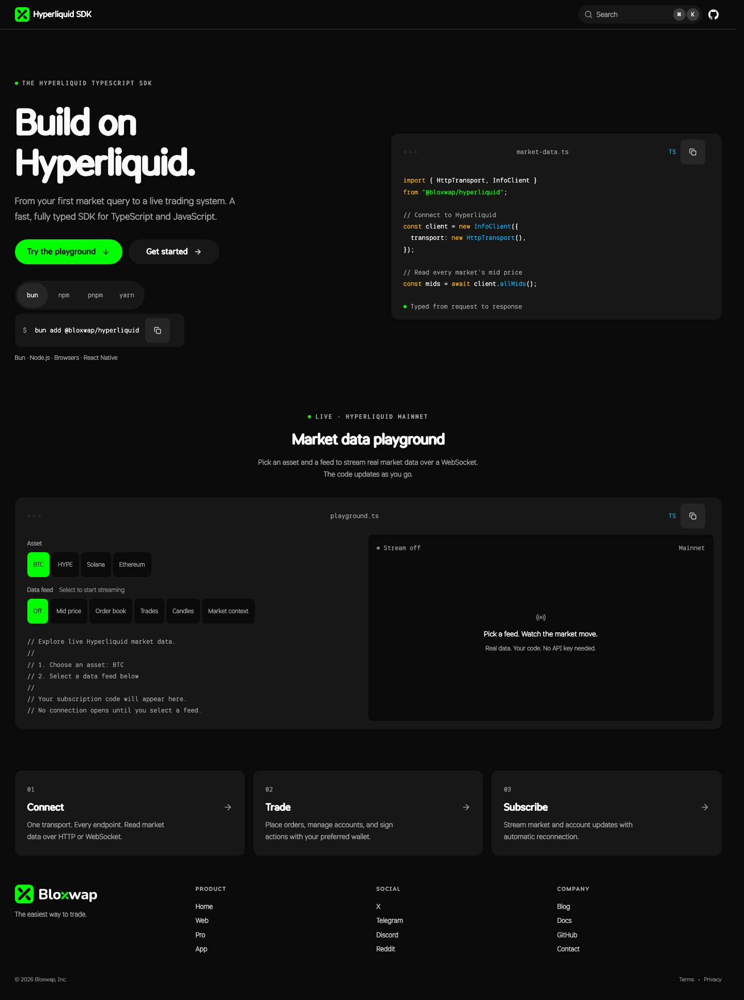 | 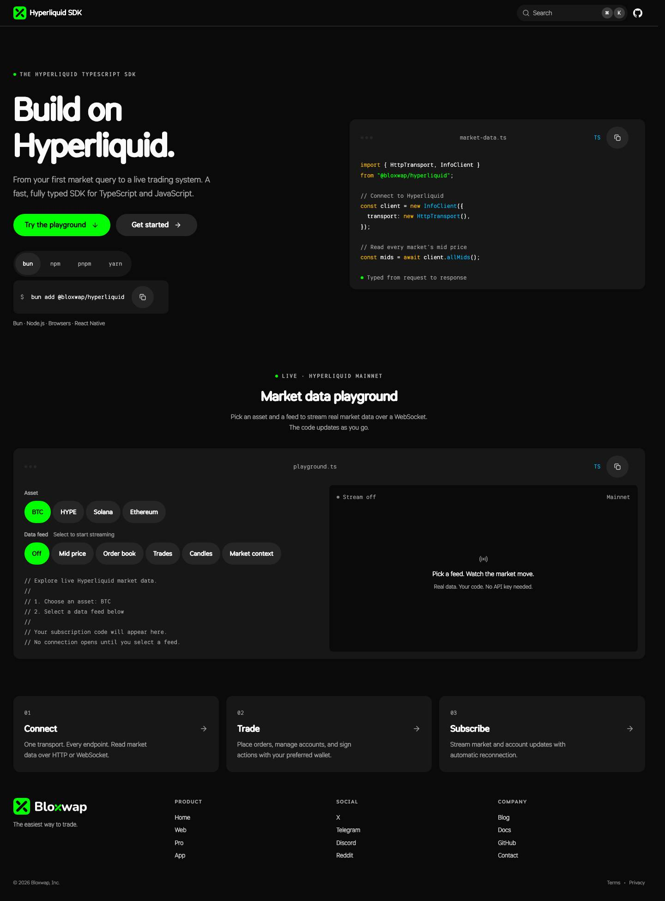 |
| Playground, desktop | 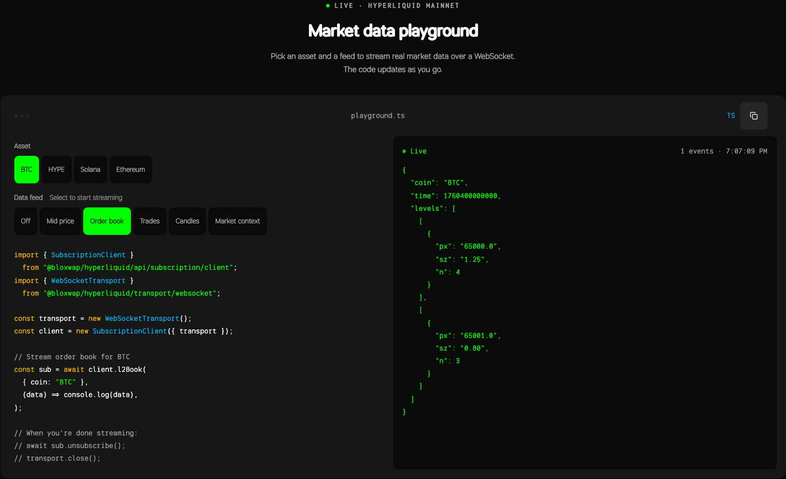 | 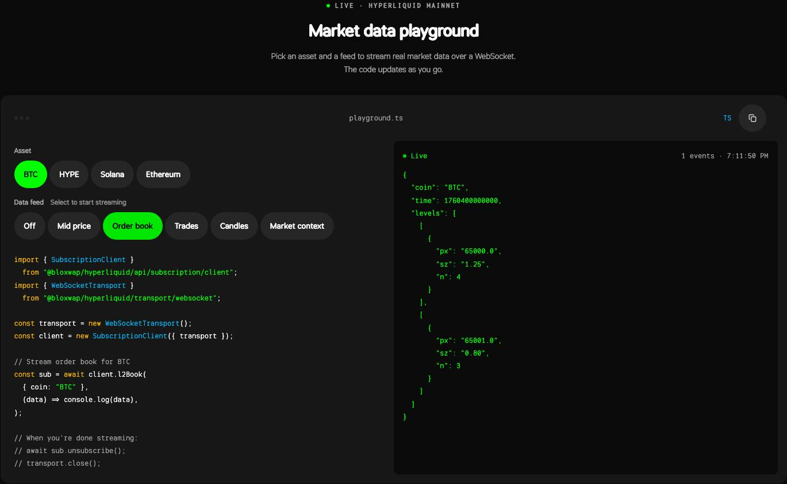 |
| Callouts, desktop | 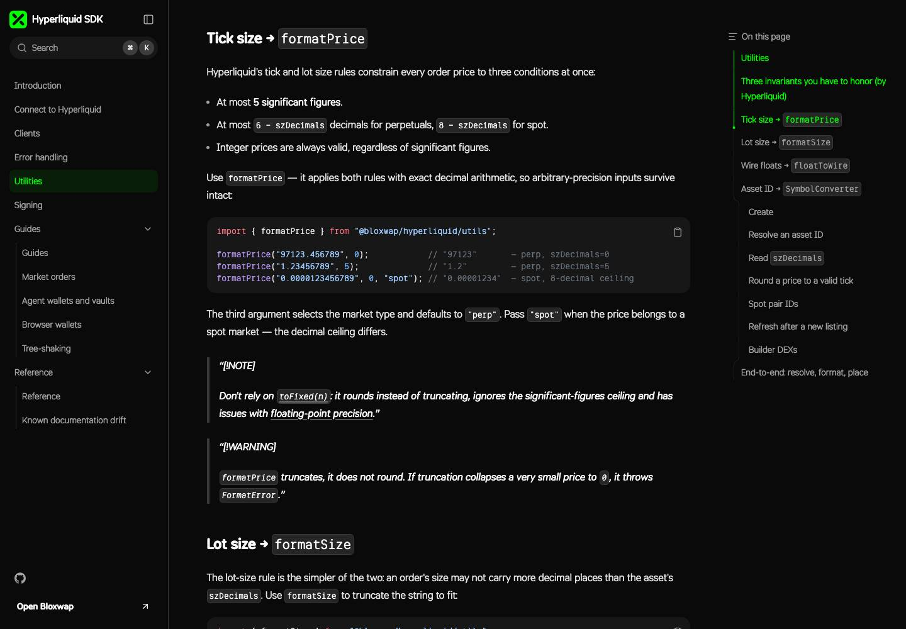 | 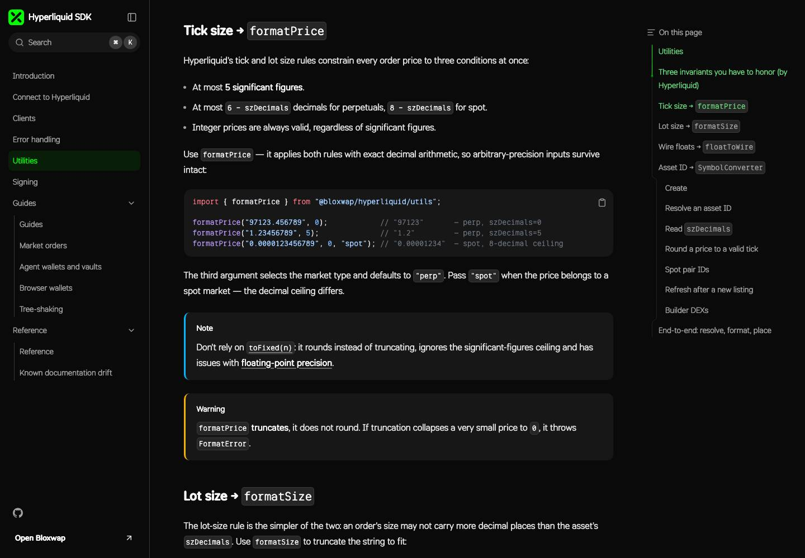 |
| Home, 390px | 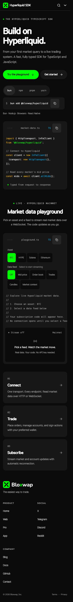 | 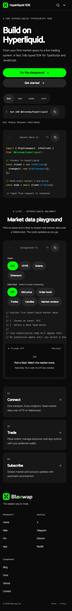 |
| Playground, 390px | 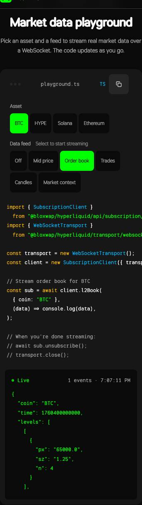 | 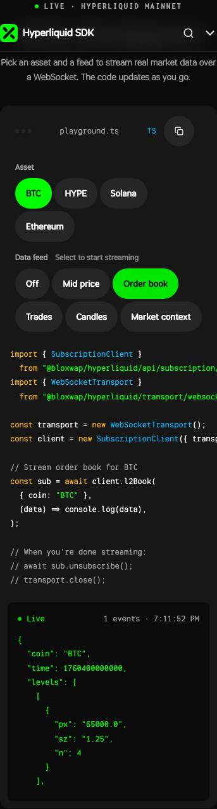 |
| Search empty, 390px | 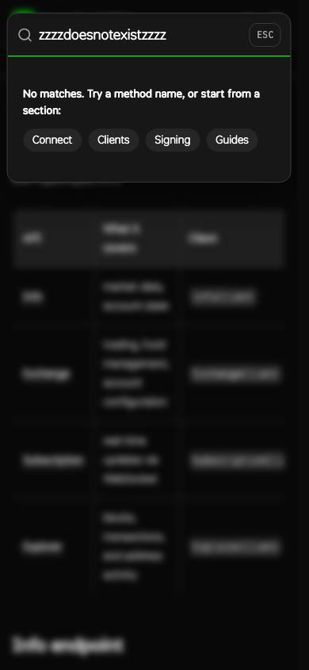 | 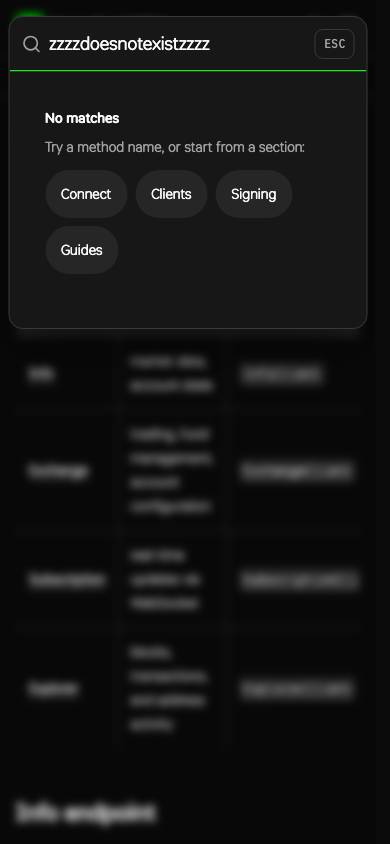 |
| Navigation, 390px | 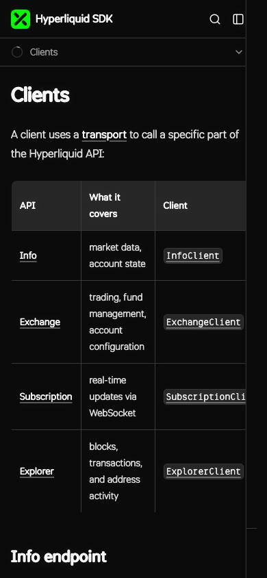 |  |

## Validation

All observations are automated (Bun, Next.js, Playwright headless Chromium). The owning PR lists the exact command
results. `bun run --cwd apps/docs test:browser` runs against the production export in CI and covers:

- shell: HIGProvider density, the HIG button recipe and 48px targets on the hero action
- install and copy: keyboard selection of a package manager, clipboard success and denial
- search: Ctrl+K, results, HIG empty state, Escape, offline index failure as a HIG alert
- mobile: 390px sidebar navigation to a deep link, large text and RTL with no horizontal overflow
- playground: real SDK subscription code against mocked frames (payload, asset change, Off), loading, server
  rejection, HIG Retry, and keyboard operation (Space toggles, Tab and Shift+Tab move focus) and code copy
- callouts: the utilities page's four GitHub alerts render as HIG callouts, not live regions, with no literal `[!NOTE]`.
  The export has ten callouts site-wide (clients 5, signing 1, utilities 4) and no literal markers.

`live-market.json` records a separate **unmocked** automated Chromium run: the production export at 390px reached Live
on `wss://api.hyperliquid.xyz/ws` and received a BTC mid-price, then stopped cleanly with Off.

## Exceptions and limits

- Candidate tarballs stand in for registry packages until bloxwap/hig#32 publishes.
- Fumadocs host adapters (navigation, search dialog, code blocks) are kept, as the migration guide allows.
- The HIG `Callout` only colors the edge for warning and error severities. The host adds the info/positive edge for note,
  important and tip callouts using HIG tokens.
- Nothing was tested on physical iOS/Android devices, with VoiceOver/TalkBack, or for tactile feedback. The site
  configures no feedback sink.

Rollback: revert this PR's commit. That restores `vendor/hig`, the copied Open Graph fonts and the previous components.
